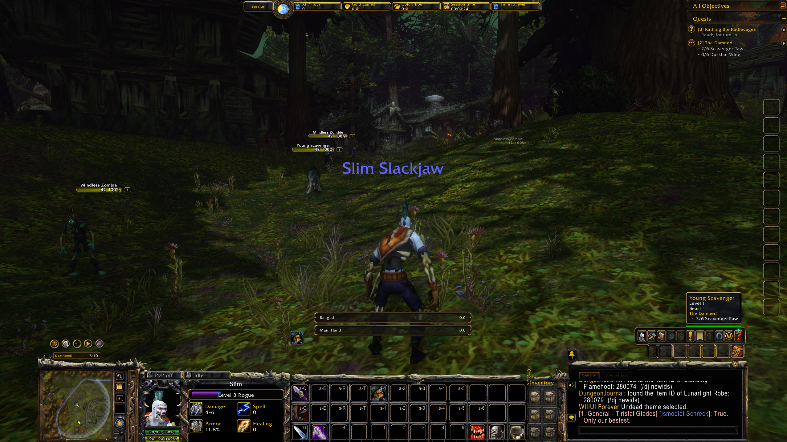
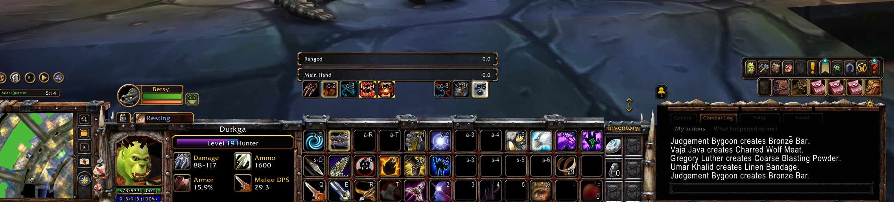
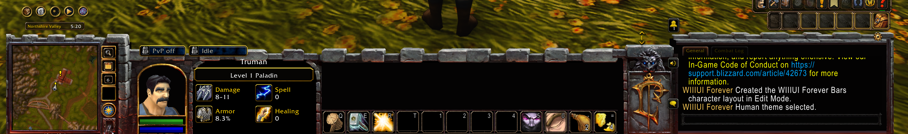
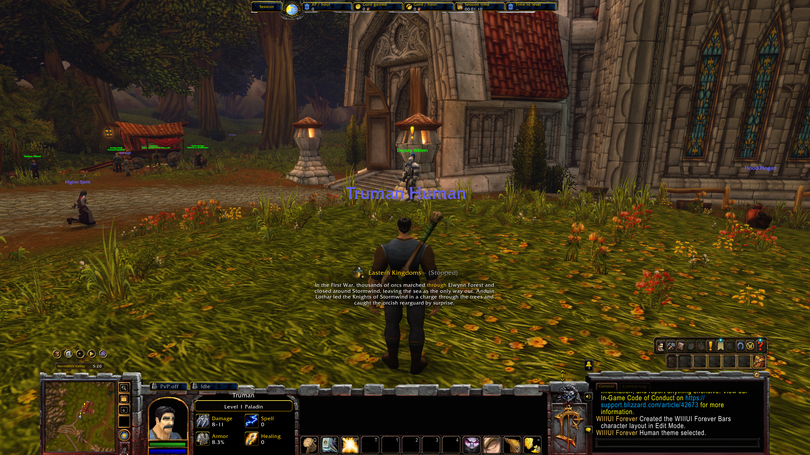
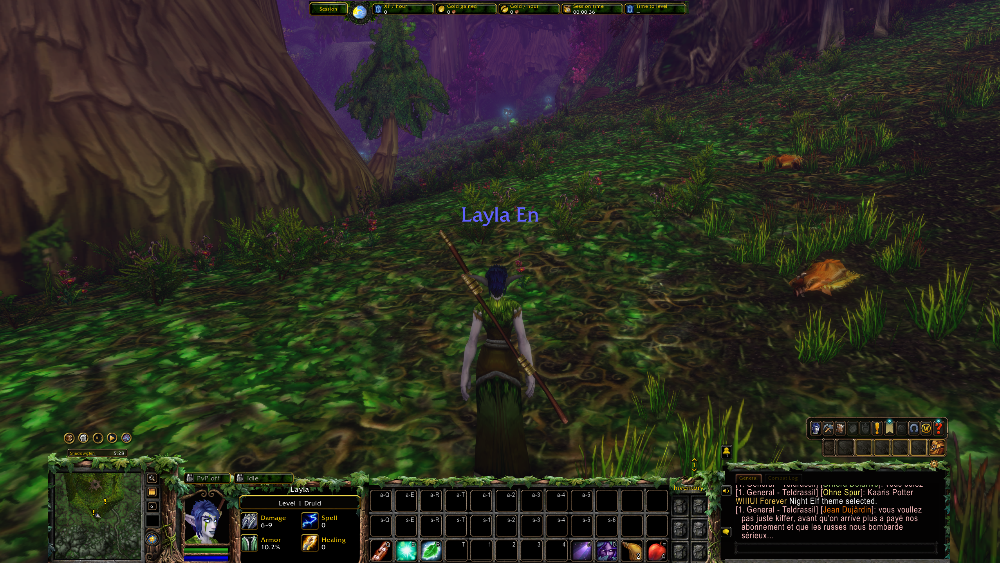

# WIIIUI Forever

**A Warcraft III-inspired UI reimagined for World of Warcraft: Forever.**

**Alpha · v0.6.4 · Forever 1.60.1 / Interface 16001 · Lua · No required addons**

WIIIUI Forever brings Warcraft III's faction consoles into WoW Forever, with animated portraits, configurable character information, a Forsaken Kingdom-style character sheet, quick slots, and a session ribbon with a day/night clock.

This project grows out of [Fiurs-Hearth's original WIIIUI](https://github.com/Fiurs-Hearth/WIIIUI). Huge thanks and respect to **Fiur** for creating the original addon and sharing the foundation that made this possible!

This is a **reimagining for Forever**, with a different implementation and feature set. Many features and customization options from the original WIIIUI are not currently included here, and this version adds features of its own. The original addon's instructions and dependencies do not all apply to this version.

> **We're in alpha!** Expect rough edges as we test more characters, classes, resolutions, and addon combinations. Contributions, ideas, screenshots, and bug reports are very welcome. [Report an issue](https://github.com/Hmimesh/WIIIUIForever/issues) or [open a pull request](https://github.com/Hmimesh/WIIIUIForever/pulls).

## Screenshots

### Undead

The Undead console, animated portrait, optional six-slot inventory panel, and session ribbon.



### Forsaken Kingdom-style character sheet

A Warcraft III-inspired character window with equipment, stats, and a separate movable inventory panel. Choose all carried bags, the backpack, an individual bag, or hide the inventory panel.


### Options through the cog

Choose your theme, character stats, PvP/combat indicators, ribbon, health/resource text, portrait framing, quick slots, and character inventory from the cog above chat.


### Orc with a pet

The Orc console with a pet frame and configurable equipment-aware stats, including ammo and weapon DPS.



### Human starter layout

A fresh character using one action bar with the optional six quick slots hidden. Enable additional action bars in WoW's settings as you need them.



The Human theme with its session ribbon and day/night clock:



### Night Elf with ribbon and HD visuals

The Night Elf console and matching ribbon, shown on a client using HD visuals. HD world graphics are not supplied by this addon.



Some screenshots also show other installed addons; those are not bundled with WIIIUI Forever.

## Install

1. Download this repository using **Code → Download ZIP**, then extract it.
2. Copy the inner **`WIIIUIForever`** folder into your Forever client's AddOns directory:

   ```text
   World of Warcraft/
   └── _forever_/
       └── Interface/
           └── AddOns/
               └── WIIIUIForever/
                   ├── WIIIUIForever.toc
                   ├── WIIIUIForever.lua
                   └── art/
   ```

3. Restart the client if it was already running, and enable **WIIIUI Forever** in the AddOn list.
4. Open the **cog above chat** to configure the UI. The Human theme is the default.

Install the `WIIIUIForever` folder itself, rather than the entire downloaded repository. This build targets **WoW Forever**; compatibility with other WoW clients has not been established. You do not need MoveAnything or the original WIIIUI installed.

## What you can customize

- **Four faction themes:** Human, Orc, Undead, and Night Elf.
- **Native action buttons, minimap, and chat:** arranged within a Warcraft III-style console. A separate **WIIIUI Forever Bars** Edit Mode layout keeps the previous layout available.
- **Animated portrait:** per-character X/Y/Z controls, camera lock, reapply, and reset options.
- **Health and resource text:** numbers, percentage, both, or none, chosen independently for health and mana/rage/energy/other resources.
- **Four character stat slots:** choose weapon damage, armor, ammo, weapon DPS, crit, spell/healing information, rested XP, combat DPS, or highest-damage ability. Equipment-related stats use equipped item icons where supported.
- **Combat information:** current-fight DPS and leading ability DPS from Forever's native damage meter, resetting for each combat session.
- **XP and rested XP:** a styled level bar with a rested segment and hover details.
- **PvP and combat indicators:** icon, text, both, or hidden; choose Warcraft/simple frames and whether inactive indicators remain visible.
- **Six optional quick slots:** drag items or spells into the panel between the action bars and chat. Hide the panel without losing assignments.
- **Forsaken character window:** movable character sheet and inventory panel, with selectable bag views.
- **Session ribbon:** configurable XP/hour, gold gained, gold/hour, session time, estimated time to level, current money, rested XP, and other fields; optional faction backing and a Warcraft III day/night clock.

See the [configuration guide](docs/CONFIGURATION.md) for controls, saved settings, and details.

### Chat commands

```text
/wiiiui human
/wiiiui orc
/wiiiui undead
/wiiiui nightelf
/wiiiui off
/wiiiui on
```

`off` restores the native layout; `on` brings back the console. Make protected layout and quick-slot changes outside combat; changes that require it are deferred until combat ends.

## Alpha testing and contributions

We want this to work across more characters and setups, and we'd love your help. **Bug reports and contributions are very welcome!**

When reporting a problem, include:

- Addon version and Forever client version.
- Character race/class, selected theme, resolution, and UI scale.
- What you did, what you expected, and what happened instead.
- A screenshot and the first Lua error, if there is one.
- Whether it happens after login, `/reload`, leveling, combat, or an equipment change, and which other UI addons are enabled.

Portrait framing, reload/appearance transitions, and interactions with other UI addons are still being refined. Combat statistics depend on the native damage meter being available. See [CONTRIBUTING.md](CONTRIBUTING.md) to get started.

## Credits and upstream

**Thank you, Fiur!** This project is a fork and Forever-specific reimagining of [Fiurs-Hearth/WIIIUI](https://github.com/Fiurs-Hearth/WIIIUI). Please visit the original project and give its creator your support. The original faction console artwork comes from that project; additional Warcraft III artwork was converted from the locally installed game for the Forsaken panels, ribbon, clock, and indicators.

Warcraft, Warcraft III, and World of Warcraft artwork and trademarks belong to Blizzard Entertainment. See [CREDITS.md](CREDITS.md) for asset provenance. This is a community project, not an official Blizzard addon.
