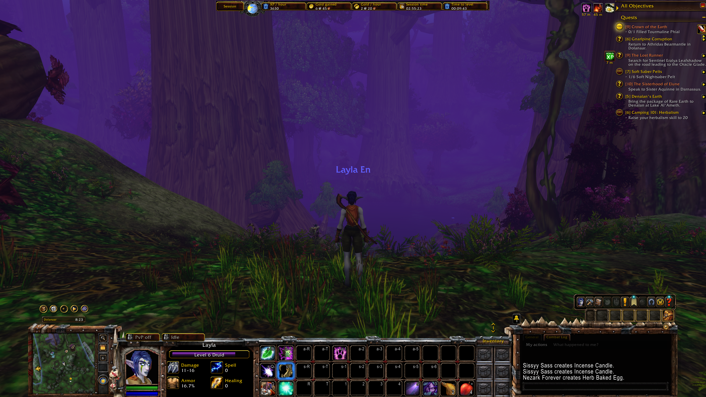
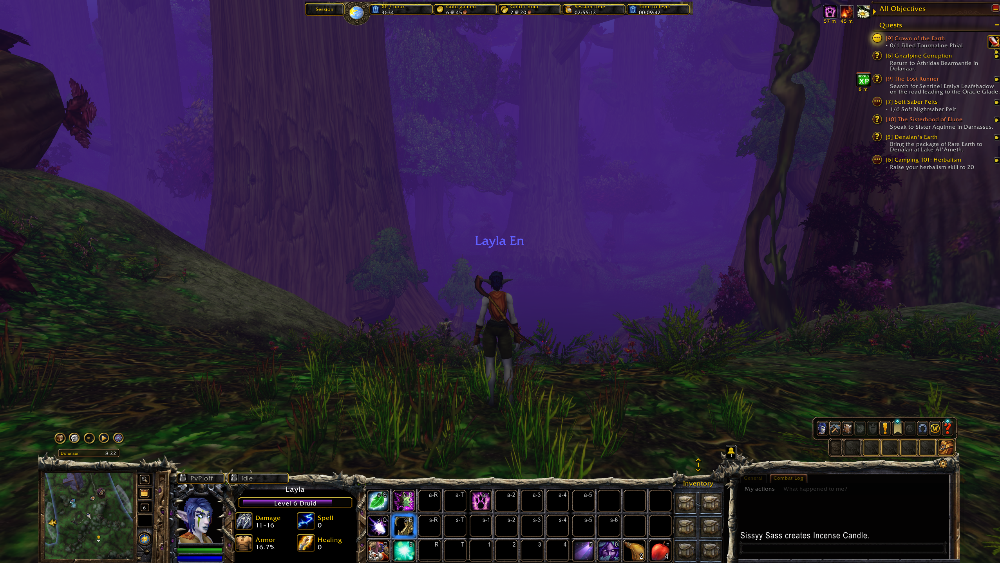
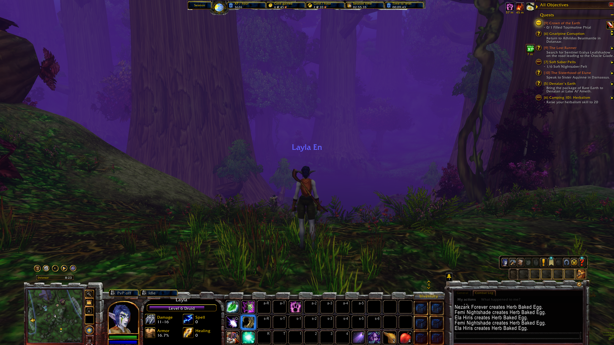
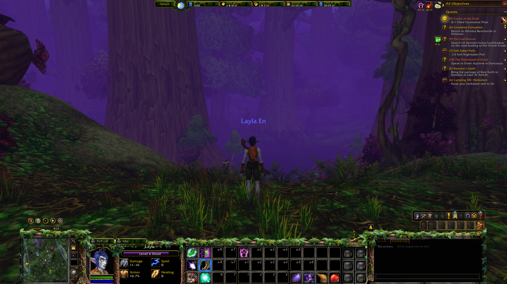
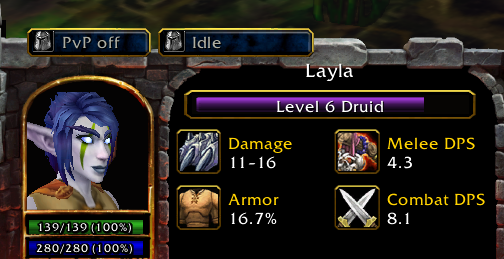
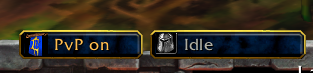
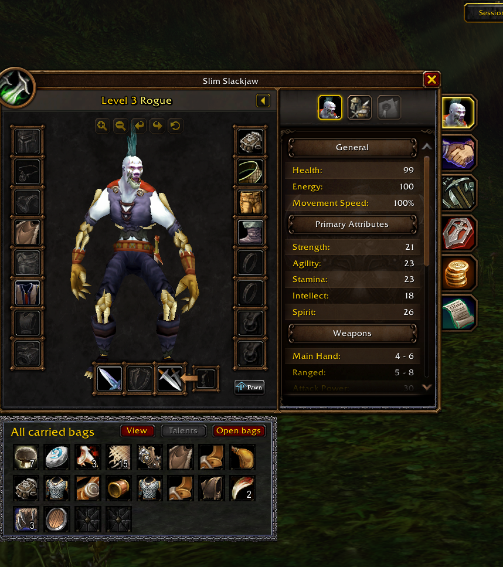
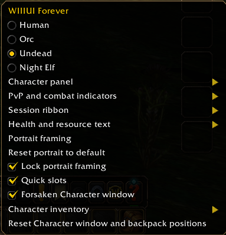

# WIIIUI Forever

### Bring the Warcraft III command console into World of Warcraft: Forever.

**Four faction-inspired interfaces. Animated character portraits. A customizable HUD. One familiar Warcraft III feeling.**

[](https://github.com/Hmimesh/WIIIUIForever)
[](https://github.com/Hmimesh/WIIIUIForever)
[](https://github.com/Hmimesh/WIIIUIForever)
[](https://github.com/Hmimesh/WIIIUIForever/issues)

WIIIUI Forever reimagines [Fiur's original WIIIUI](https://github.com/Fiurs-Hearth/WIIIUI) for the **WoW Forever** client. It frames WoW's native controls in Warcraft III-inspired faction consoles, adds practical customization, and gives your character screen a classic strategy-game look.

> **Alpha — v0.6.13-alpha2.** Made for **Forever 1.60.1 / Interface 16001**. Expect some rough edges. Other WoW clients are **not** currently supported or tested. Contributions and bug reports are welcome.

This update refines the four faction borders, gives each theme its own chat-border textures, fits the XP bar inside the character panel, and aligns the six quick slots with their artwork. See the [changelog](WIIIUIForever/CHANGELOG.txt).

<p align="center">
  
  
</p>

**[Install](#installation)** · **[Features](#features-at-a-glance)** · **[Customization guide](docs/CONFIGURATION.md)** · **[Report a bug](https://github.com/Hmimesh/WIIIUIForever/issues)**

## Features at a glance

| Feature | What it brings |
| --- | --- |
| **Four faction themes** | Human, Orc, Undead, and Night Elf Warcraft III-style consoles. |
| **Animated portrait** | Character portrait with per-character camera positioning and reset controls. |
| **Native WoW controls** | Action bars, chat, and minimap arranged in the console; a separate Edit Mode layout preserves your previous arrangement. |
| **Custom stat display** | Four selectable slots for damage, armor, ammo, DPS, crit, spell/healing details, rested XP, and more. |
| **Six quick slots** | An optional item/spell panel that remembers assignments when hidden. |
| **Restyled XP bar** | Level progress, rested segment, and hover details. |
| **Session ribbon** | XP/hour, gold earned, gold/hour, session length, time-to-level estimate, and more, plus an optional day/night clock. |
| **Character and inventory windows** | Forsaken Kingdom-inspired character sheet and movable bag panel. |
| **Combat and PvP indicators** | Configurable indicator styles and visibility; combat statistics use Forever's native damage meter. |

No required companion addons. No MoveAnything or original WIIIUI installation needed.

## See it in action

### The four faction consoles

**Orc — wood, metal, and the spiked chat border**


**Undead — animated portrait, quick slots, and session ribbon**


**Human — stone console and day/night ribbon**



**Night Elf — faction console and ribbon**



*The four theme screenshots show the same Night Elf character switching console styles. Character race does not restrict your theme choice. Client world visuals and other addons visible in screenshots are not bundled.*

### Stats and status at a glance



Choose the four stats under your level bar and show health and resources as numbers, percentages, both, or neither.



PvP and combat indicators can use icons, text, or both, with configurable styling and visibility.

### A character sheet worthy of a Warcraft III hero



Move the character sheet and inventory separately. Display all carried bags, the backpack, an individual bag, or no inventory panel.

### Make it your own



Use the **cog above chat** to adjust themes, stat slots, portrait framing, health/resource text, PvP indicators, quick slots, inventory, and the session ribbon. Detailed controls are in the [configuration guide](docs/CONFIGURATION.md).

## Installation

1. Click **Code → Download ZIP** on this repository and extract the archive.
2. From the extracted repository, copy **only the inner `WIIIUIForever` folder** into your Forever client's addon directory:

   ```text
   World of Warcraft/
   └── _forever_/
       └── Interface/
           └── AddOns/
               └── WIIIUIForever/
                   ├── WIIIUIForever.toc
                   ├── WIIIUIForever.lua
                   ├── Art.lua
                   └── art/
   ```

3. Restart the game if needed, and enable **WIIIUI Forever** in the AddOn list.
4. Open the **cog above chat** to configure your interface. **Human** is the default theme.

**Important:** Don't copy the whole downloaded repository into `AddOns`; the folder containing `WIIIUIForever.toc` should sit directly inside `AddOns`.

## Quick commands

```text
/wiiiui human
/wiiiui orc
/wiiiui undead
/wiiiui nightelf
/wiiiui off
/wiiiui on
```

Switch to a faction theme using its name. `/wiiiui off` restores the native layout; `/wiiiui on` returns to the console.

Some layout and quick-slot updates are protected during combat and will apply when combat ends.

## Customization details

- **Portrait:** X/Y/Z framing, camera lock, reapply, and reset.
- **Health and resources:** independent numeric, percentage, both, or hidden displays.
- **Stats:** four slots for weapon damage, armor, ammo, weapon DPS, crit, spell/healing info, rested XP, current-fight DPS, or highest-damage ability. Equipment icons are shown where supported.
- **Indicators:** PvP/combat icons, text, both, or hidden; Warcraft/simple frames and inactive visibility options.
- **Quick slots:** drag items or spells to the optional six-slot panel; hiding it retains assignments.
- **Ribbon:** select session metrics, optional faction backing, and Warcraft III day/night clock.
- **Inventory:** choose combined bags, backpack, individual bag, or hide the separate inventory window.

See **[CONFIGURATION.md](docs/CONFIGURATION.md)** for all settings and how they're saved.

## Alpha status and known limitations

This project is actively evolving. Portrait framing, reload and appearance transitions, support across resolutions/UI scales, and compatibility with other UI addons are still being refined. Combat statistics require the native Forever damage meter.

**Found a bug or have an idea?** [Open an issue](https://github.com/Hmimesh/WIIIUIForever/issues) with:

- Addon version, Forever client version, character race/class, and selected theme.
- Screen resolution, UI scale, and other enabled UI addons.
- Steps to reproduce, expected result, and actual result.
- A screenshot and the first Lua error (if any).
- Whether it happens after login, `/reload`, leveling, combat, or an equipment change.

Contributions are welcome. See [CONTRIBUTING.md](CONTRIBUTING.md) or [open a pull request](https://github.com/Hmimesh/WIIIUIForever/pulls).

## Credits and attribution

Original code is available under the [MIT License](LICENSE.md). Third-party artwork and upstream material keep their existing ownership and terms and are excluded from that license.

WIIIUI Forever is a Forever-specific fork and reimagining of **[Fiurs-Hearth/WIIIUI](https://github.com/Fiurs-Hearth/WIIIUI)**. Huge thanks to **Fiur** for the original addon and the faction console foundation. This project has a different implementation and feature set; instructions and dependencies from the upstream project do not necessarily apply.

There are other forks and reimaginings of WIIIUI, including **[Warcraft 3 UI: Forever Edition](https://www.curseforge.com/wow/addons/warcraft-3-ui-forever-edition)** by Infinityaddons. WIIIUI Forever is an optional sidegrade for players who prefer this version's features and layout. Choose whichever version suits you.

Original faction console artwork comes from upstream WIIIUI. Additional Warcraft III artwork was converted from a locally installed game for the Forsaken panels, ribbon, clock, and indicators. See [CREDITS.md](CREDITS.md) for asset provenance.

Warcraft, Warcraft III, and World of Warcraft artwork and trademarks belong to Blizzard Entertainment. This is an unofficial community project, not affiliated with or endorsed by Blizzard.
